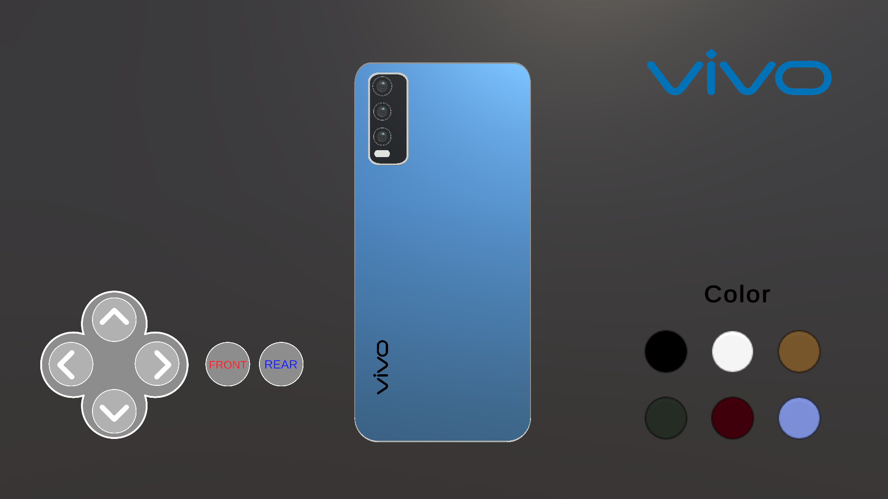

## 🔗 Live Demo & Video Showcase | Demo Interaktif & Video

**Try the interactive 3D showcase directly in your browser:**

🚀 [**Play Vivo Y20 Interactive Showcase on itch.io**](https://zidhan-yanotama.itch.io/vivo-y20-interactive-phone-showcase)

**Watch the video showcase:**

🎬 [**Vivo Y20 – 3D Product Showcase (YouTube)**](https://youtu.be/QmE82cDVa7s)

# Vivo Y20 – Interactive 3D Product Showcase

An interactive 3D smartphone showcase featuring the Vivo Y20, developed using Unity. The application allows users to explore the smartphone from different angles, switch between front and rear views, and customize its case with six different color options.

Showcase 3D interaktif smartphone Vivo Y20 yang dikembangkan menggunakan Unity. Aplikasi ini memungkinkan pengguna melihat smartphone dari berbagai sudut, berpindah antara tampilan depan dan belakang, serta mengubah warna casing dengan enam pilihan warna.

---

## 📱 Project Preview | Pratinjau Proyek



## 🎯 About the Project | Tentang Proyek

**English**

This project was developed as an interactive multimedia application to showcase the Vivo Y20 smartphone through a 3D environment. It provides interactive controls that allow users to explore the device's physical appearance and customize its case color.

**Indonesia**

Proyek ini dikembangkan sebagai aplikasi multimedia interaktif untuk menampilkan smartphone Vivo Y20 dalam lingkungan 3D. Aplikasi ini menyediakan kontrol interaktif yang memungkinkan pengguna mengeksplorasi tampilan fisik perangkat dan menyesuaikan warna casing.

## ✨ Features | Fitur

- **Directional Controls | Kontrol Arah** – Rotate the 3D smartphone using left, right, up, and down buttons / Memutar model smartphone 3D menggunakan tombol kiri, kanan, atas, dan bawah.
- **Front & Rear View | Tampilan Depan & Belakang** – Switch between front and rear smartphone views / Berpindah antara tampilan depan dan belakang smartphone.
- **Case Color Customization | Kustomisasi Warna Casing** – Choose from six different case color options / Memilih enam pilihan warna casing yang tersedia.
- **3D Product Visualization | Visualisasi Produk 3D** – Explore the Vivo Y20 model in an interactive 3D environment / Mengeksplorasi model Vivo Y20 dalam lingkungan 3D interaktif.

## 🛠️ Technologies | Teknologi

- Unity
- C#
- 3D Models (FBX)
- Unity UI

## 📂 Project Structure | Struktur Proyek

```text
vivo-y20-interactive-3d-showcase/
├── Assets/
│   ├── Scenes/
│   ├── Scripts/
│   ├── Models/
│   ├── Materials/
│   └── ...
├── Packages/
├── ProjectSettings/
├── Screenshots/
│   └── vivo-y20-showcase.png
├── .gitignore
└── README.md
```

*Note: The folder structure above represents the main project components.*

*Catatan: Struktur folder di atas menggambarkan komponen utama proyek.*

## 🚀 Getting Started | Cara Menjalankan

**English**

1. Clone this repository.
2. Open Unity Hub.
3. Select **Add Project from Disk**.
4. Choose the downloaded project folder.
5. Open the project using a compatible Unity Editor version.
6. Open the main scene from the `Assets/Scenes` folder.
7. Press Play to explore the showcase.

**Indonesia**

1. Clone repository ini.
2. Buka Unity Hub.
3. Pilih **Add Project from Disk**.
4. Pilih folder project yang sudah diunduh.
5. Buka project menggunakan versi Unity Editor yang kompatibel.
6. Buka scene utama dari folder `Assets/Scenes`.
7. Tekan Play untuk menjalankan showcase.

## 📝 Notes | Catatan

**English**

This repository contains the Unity project source files, including 3D assets, scenes, and scripts. The project was originally published as a browser-based interactive showcase on itch.io.

**Indonesia**

Repository ini berisi file source project Unity, termasuk aset 3D, scene, dan script. Proyek ini sebelumnya telah dipublikasikan sebagai showcase interaktif berbasis browser di itch.io.

---

**Interactive Multimedia Project | Proyek Multimedia Interaktif**
